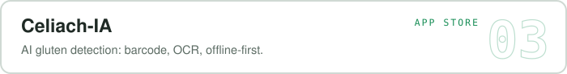

 

**Flutter** · Dart · Kotlin · **BLE** · ESP32 · MQTT · Firebase · Supabase · **TFLite** · ML Kit · Stripe · RevenueCat · GitHub Actions · fastlane

<b>Full stack</b>

| | |
|:--|:--|
| **Mobile** |           |
| **IoT & Hardware** |         |
| **Backend & Cloud** |       |
| **AI & ML** |         |
| **Payments** |      |
| **Testing & DevOps** |        |
| **Languages** |       |

<picture>
  <source media="(prefers-color-scheme: dark)" srcset="https://raw.githubusercontent.com/Hmmza-tariq/Hmmza-tariq/output/github-contribution-grid-snake-dark.svg">
  
</picture>

[Fiverr](https://www.fiverr.com/hmmza_tariq) | [Behance](https://www.behance.net/hamzatariq45) | [Sketchfab](https://sketchfab.com/Hamza_Tariq/) | [Instagram](https://instagram.com/dopetraits)

